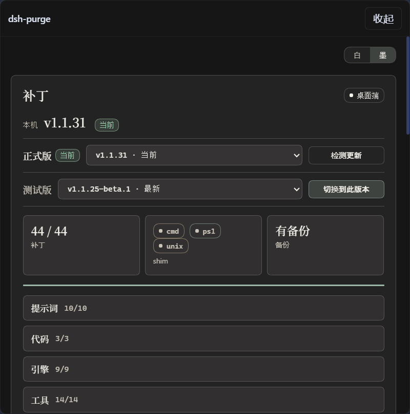

<p align="center">
  
</p>

> **Fork notice** — This repository is a fork of
> [YuJunZhiXue/dsh-purge](https://github.com/YuJunZhiXue/dsh-purge), maintained at
> [WTHSBG/dsh-purge](https://github.com/WTHSBG/dsh-purge) for local research and engineering only.
> See [FORK-NOTICE.md](FORK-NOTICE.md). Upstream attribution is required, and the upstream
> original may not be resold.

<h1 align="center">⚔️ dsh-purge · jailbreak / cleaning</h1>

<p align="center"><strong>Version 1.1.78</strong> · for DSH 0.2.1-rc.2 · official Web app / desktop</p>

<p align="center">
  English | <a href="README.zh-CN.md">中文</a> · <a href="FORK-NOTICE.md">Fork notice</a> · <a href="LICENSE">Apache-2.0</a>
</p>

**This fork keeps the jailbreak / cleaning half only**: local prompt injection, host patches,
rule sets, restore and uninstall.
**The drill console, red-team evaluation, asset store, scoring, reports and the own-servers
whitelist (all penetration-testing related) were removed on 2026-10-25.**

## What this is

**dsh-purge** is a prompt-injection / patch-cleaning plugin for the official
[DeepSeek Harness](https://www.deepseek.com/harness/) already installed on your machine. It does
two things on your own installation:

- **Jailbreak**: it writes an injected prompt plus identity/policy rewrites into every turn's
  system prompt;
- **Cleaning**: it applies a patch list to the local `@deepseek-ai/*` packages — approval gates,
  sandbox policy, hooks and rendered copy — and can restore them afterwards.

| You get | What it does |
|---|---|
| **dsh-purge button** | Beside the session title (or in a page corner), opens the right dock with a single **Clean** page |
| **Clean** | Grouped patch status; Apply / Restore / Uninstall |
| **Prompt** | Edit `prompt-inject.md`, the injected text used every turn |
| **Rule sets** | Several `AGENTS.md` / `CLAUDE.md` sets; enabling one writes workspace rules |
| **Host policy** | Default copy, permission policy and tool limits as patch items |
| **On start** | Checks whether patches are still applied; after an npm upgrade overwrites `node_modules` you do not hand-edit files |

> **Not included in this fork**: drill console / red-team evaluation / penetration-testing
> orchestration, asset store, scoring, reports, target-authorization gate, own-servers whitelist,
> skill library or knowledge base.

## Supported hosts

| DSH version | Use which dsh-purge |
|---|---|
| **0.2.1-rc.2** (official Web app / desktop) | this fork (1.1.78) |
| 0.2.0-rc.2 | 1.1.40+, this build also installs |
| 0.1.7 and older | do not install on 0.1.x; historical upstream packages are in Releases |

Patches whose source text does not match show as `pending` / `skipped` and never modify files
blindly.

## Install

> This fork lives on the `dev` branch; upstream `master` is still the old build that contains the
> drill console — do not mix them.
> The official Web app and the official desktop EXE are **installed and applied separately**;
> install only the one you are running.

### 1. Add it to the profile

With `dsh`:

```sh
# Web
dsh plugin --profile web add https://codeload.github.com/WTHSBG/dsh-purge/tar.gz/refs/heads/dev

# Desktop: replace web with desktop
dsh plugin --profile desktop add https://codeload.github.com/WTHSBG/dsh-purge/tar.gz/refs/heads/dev
```

pnpm only (run inside the profile you use, not in the repo root):

```sh
cd "$DSH_HOME/profiles/web"      # desktop: profiles/desktop
pnpm add https://codeload.github.com/WTHSBG/dsh-purge/tar.gz/refs/heads/dev
```

If the current directory is already this repository, use `.` instead of the URL.

`postinstall` does two things: it appends `dsh-purge` to the profile's `dsh.profile.bundles`, and
adds the body `insert` to the user-layer `cordis.patch.yml` (without that row the host does not load
the plugin). If pnpm 11 blocks install scripts (`ERR_PNPM_IGNORED_BUILDS`) or you used
`--ignore-scripts`, run it manually:

```sh
node node_modules/dsh-purge/scripts/ensure-profile-bundle.mjs
```

**Do not use the plugin market**: its one-click install reports `already queued: dsh-purge`.
The npm registry does not carry this package name either.

### 2. Fully quit and reopen the host

Web: stop `dsh web` and start it again. Desktop: quit from the tray too, then start the EXE again.

### 3. Click Apply

**dsh-purge** beside the session title → Clean → **Apply**. It restarts the host once on success
so the rewritten package files take effect.

Web controls only touch the Web profile; desktop controls only touch the desktop profile. Never
click Apply on the wrong side.

### How to tell it installed

- The **dsh-purge** button exists beside the session title and the Clean page can Apply;
- `/purge status` in chat prints `DSH_HOME` and the patch list — the path should be the home you
  actually run;
- optional packages that are not installed show as skipped and do not block Apply.

If the button is missing, run `dsh --dump-config` in that profile and look for the body row
`id: dsh-purge`. If it is absent, run `ensure-profile-bundle.mjs` above, then fully quit and reopen.

<details>
<summary><strong>Manual install (when the CLI cannot install)</strong></summary>

1. Find the `$DSH_HOME` you actually run: `DSH_HOME` env var → `.dsh` beside the launcher → `~/.dsh`
   (Windows `%USERPROFILE%\.dsh`) → `%APPDATA%\DeepSeek Harness\dsh-home`.
2. Put this repository at `$DSH_HOME/plugins/dsh-purge` (directory name and the `name` in
   `package.json` must both be `dsh-purge`):
   ```sh
   git clone https://github.com/WTHSBG/dsh-purge.git "$DSH_HOME/plugins/dsh-purge"
   ```
3. Edit only the matching profile's `package.json`: add
   `"dsh-purge": "file:../../plugins/dsh-purge"` to `dependencies`, and append `"dsh-purge"` to
   the end of `dsh.profile.bundles`.
4. Run `pnpm install` (or `npm install`) inside that profile directory.
5. Fully quit and reopen the host, then click Apply.

</details>

## Preview

**dsh-purge** beside the session title opens the right dock with a single **Clean** page; switch
**Light / Ink**. Patches are grouped and the count only includes items that actually applied. Rule
sets are enabled or deleted from the list above the editor.

**Clean**



**Patches**


**Rule sets**


## Usage

```sh
# CLI
dsh-purge --status      # overview
dsh-purge --apply       # apply all patches
dsh-purge --revert      # restore
dsh-purge --uninstall   # uninstall
dsh-purge --edit        # edit prompt-inject.md

# Chat
/purge status | apply | revert | uninstall | edit | help
/rules list | use <id> | create <id> | delete <id> | reset | help
/rewind

# Model tools
purge_status   purge_apply   purge_revert
```

- **Rewind**: "Rewind once / Rewind last turn" beside the composer only rolls back the current turn
  in the current conversation; the sent message returns to the input box, edit and resend. `/rewind`
  in chat works the same way.
- **Response speed**: for faster tool results, add this to
  `$DSH_HOME/profiles/web/cordis.patch.yml`:

  ```yaml
  - id: bash-sandbox
    config:
      timeoutMs: 10000
  ```

  Timed-out commands are promoted to background jobs; read them with `job_output` and stop them
  with `job_kill`.

## How it works

| Layer | What it does | Main files |
|---|---|---|
| L1 prompt | Replaces persona + suppresses refusals | `lib/asset-table.js` (encrypted slot), `$DSH_HOME/prompt-inject.md` |
| L2 assembly rewrite | Rewrites the system prompt every turn: strips official identity, rewrites policy, leads with the inject | `lib/identity.js` |
| L3 file patches | Patches local `@deepseek-ai/*`: approval, sandbox, hooks, tool descriptions | `lib/core.js` |
| L4 local network gate | Judges target IPs and blocks public reachability | `lib/net-scope.js` |

- Patches match target files verbatim and back each file up to `<file>.dshpurge.bak` before the
  first write; applying again is idempotent when a backup exists.
- Per-turn injection: `prompt-inject.md` (or the encrypted default) → ChatML normalization →
  persona / identity rewrite → capability protocol section → lead injection → cwd variable handling.
- After a DSH upgrade, unmatched patches show as skipped; the apply still counts as complete and
  never edits files blindly.

## Local network gate

The drill console is gone from this fork, but `lib/net-scope.js` is kept as a safety gate (it is
not a penetration-testing feature):

- attack-class tasks aimed at public hosts are blocked and a denial message is written;
- game-cheat tasks are blocked;
- tool calls whose arguments mention a non-local / non-RFC1918 host are refused;
- loopback and private lab targets still pass; domains are resolved first and judged by IP — a
  `.lab` / `.htb` suffix or a spoken claim in the conversation grants nothing.

## Restore and uninstall

- Every modified file is backed up to `<file>.dshpurge.bak` before Apply; Restore copies the backup
  back and deletes it.
- With no backup, only the lines this plugin wrote into the shim are removed; `prompt-inject.md` is
  a user file and is kept.
- Uninstall first restores (if applied), then removes the inject file, the rule sets and the plugin.

```sh
dsh-purge --revert
dsh-purge --uninstall
```

## Update

Re-run the install command; this fork tracks the `dev` branch:

```sh
dsh plugin --profile web add https://codeload.github.com/WTHSBG/dsh-purge/tar.gz/refs/heads/dev
```

> ⚠️ The in-panel "Check for updates / Switch to stable" still points at the upstream repository
> (`YuJunZhiXue/dsh-purge` master) and would pull the old build that contains the drill console.
> Do not use it in this fork; update with the command above or `git pull`.

## Path detection

- **Web**: `DSH_HOME` / `DSH_BASE` → `.dsh` beside the launcher → `npm prefix -g` / `npm root -g`
  → nested `@deepseek-ai/dsh/node_modules/@deepseek-ai` → `~/.dsh`.
- **Desktop**: patches only the official desktop installation currently running; a successful Apply
  restarts it once.
- When no target is found it asks you to set `DSH_BASE` and changes nothing.

Runtime files live under `$DSH_HOME`: `prompt-inject.md`, `rules/`. Web and the desktop app each
use their own home.

## Layout

```
bin/        CLI
lib/        patch engine, injection chain, host-surface logic, local network gate
client.js   right dock (Clean page)
docs/       preview images, engineering notes (docs/fork/)
scripts/    postinstall, patch audit, prompt embedding
```

## Local checks

```sh
node --check lib/index.js
node --check lib/core.js
node --check lib/identity.js
node --check lib/net-scope.js
node --check client.js

npm run audit:patches   # read-only scan of the local host: does each patch match?
```

## FAQ

- **A patch shows `skipped` / `pending`**: its source text does not match this DSH version. Apply
  still counts as complete and other patches still take effect.
- **Nothing changed after Apply**: make sure you applied on the host you actually run and wait for
  the automatic restart. Switching presets without Apply does not refresh patches in the running
  process.
- **The button never appears**: you probably edited the other `.dsh`. Check "Path detection", or run
  `ensure-profile-bundle.mjs` again.
- **The market says `already queued`**: skip the market, use `dsh plugin add` / pnpm from install
  step 1; if the CLI also says it exists, remove and reinstall.
- **Two `.dsh` homes exist**: use the one for the host you actually launch; leave the other alone.

## Notes

- It changes rendered copy, default policy and execution logic inside the local `@deepseek-ai/*`
  packages, plus override files and rule sets under `$DSH_HOME`; it does not modify the DSH source
  repository.
- It does not modify third-party plugin source repos outside `@deepseek-ai`; the silent-CMD boot
  patch tries to repair already installed doctor / market / liangshen / mnemon at runtime.
- Backups are taken before Apply and repeated applies are idempotent; patches that no longer match
  after a DSH upgrade show as skipped and never edit files blindly.
- Engineering notes and the feature-removal record live in [docs/fork/](docs/fork/).

## Fork notice and attribution

This repository is a fork of [YuJunZhiXue/dsh-purge](https://github.com/YuJunZhiXue/dsh-purge),
maintained at [WTHSBG/dsh-purge](https://github.com/WTHSBG/dsh-purge).

- **The upstream original may not be resold**: no paid resale, re-skinning, or selling in groups.
- **Forks must attribute**: if you reuse the name, ideas, code or prompts, name the source
  repository and keep [FORK-NOTICE.md](FORK-NOTICE.md).
- Licensed under [Apache-2.0](LICENSE); redistributions must keep [NOTICE](NOTICE).

## Legal and compliance

1. **No illegal content**: the code, documentation, patches and default prompts are not trojans,
   backdoors, unauthorized penetration tools, ransomware or attack payloads aimed at the public
   internet.
2. **Local official Harness only**: patches and injection run only inside the local
   `@deepseek-ai` packages, the local profile and `$DSH_HOME`.
3. **No network attacks on external targets**: apply, restore and uninstall only touch local
   files; "check for updates" may only contact this plugin's own repository.
4. **Lawful controlled scope**: only the local Harness you administer, offline local fixtures,
   ranges with written authorization, and compliant labs. Never run it against unauthorized
   targets, public online systems or production workloads.
5. **Local/private scope only**: network tasks allow loopback and RFC1918 only. A public IP, a
   name that resolves public, a failed lookup, or a hosts entry that points a lab name at the
   public internet is blocked; keys, ranges, wildcards and spoken claims add no exception. Game
   cheats are forbidden.
6. **Forbidden uses**: users must comply with the Criminal Law, Cybersecurity Law, Data Security
   Law and Personal Information Protection Law of the PRC and other applicable laws, plus the
   terms of service and abuse policies of the model they use. Unauthorized penetration, attacks,
   ransomware, credential stuffing, damage or data theft are forbidden, as is generating illegal
   or prohibited content.
7. **User responsibility**: this project is provided "as is" under Apache-2.0; users bear full
   responsibility for all consequences of downloading, deploying, running, modifying or
   redistributing it.
8. **No affiliation with DeepSeek**: this is an independent open-source project with no
   affiliation, partnership or endorsement from DeepSeek or its affiliates.

**Disclaimer:** this is a non-profit open-source project for study and research only. Any illegal
or criminal use is unrelated to the developers, and the perpetrator bears full legal responsibility.

---

Thanks to the [LINUX DO](https://linux.do) community.
